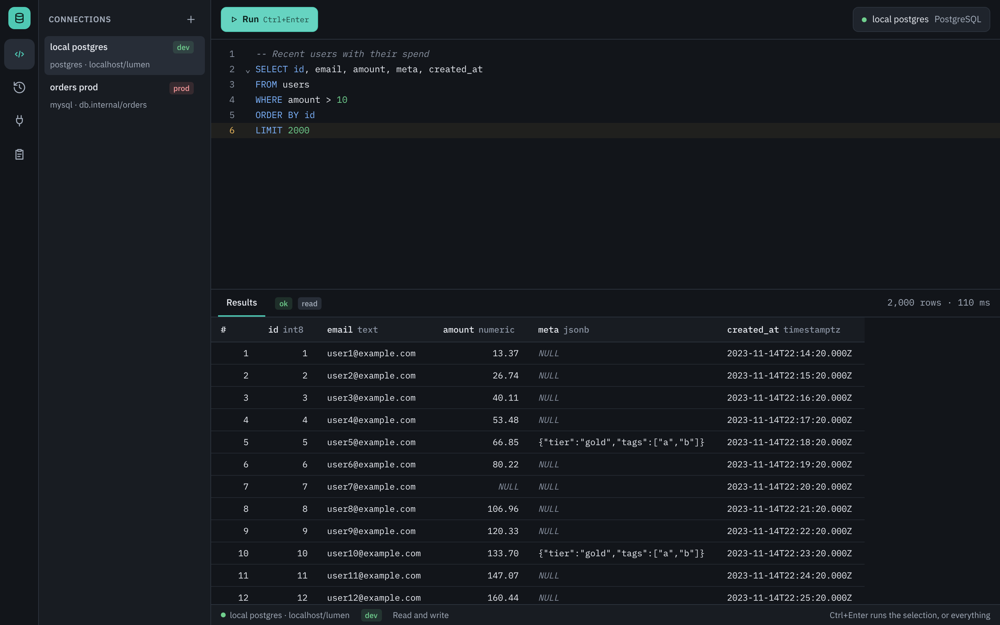
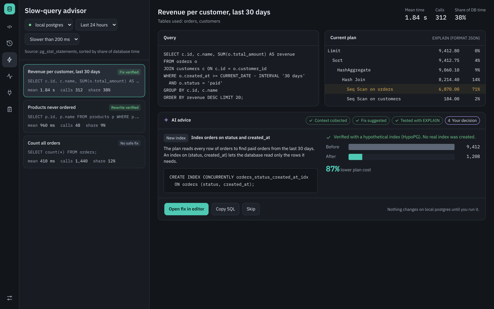
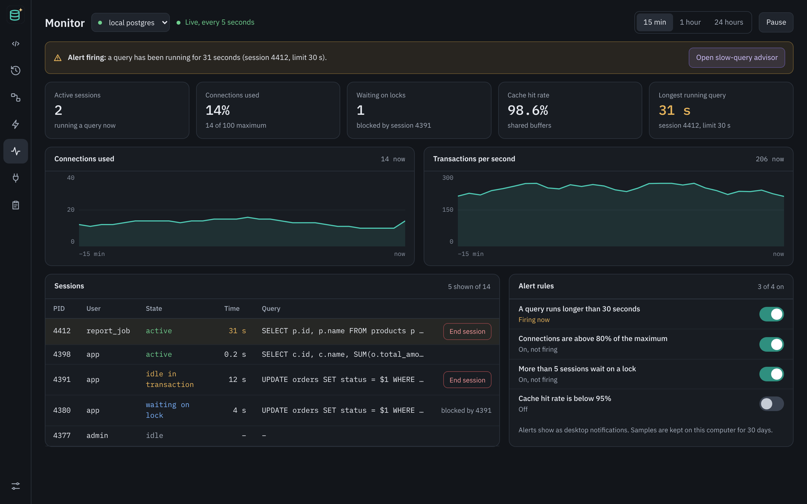
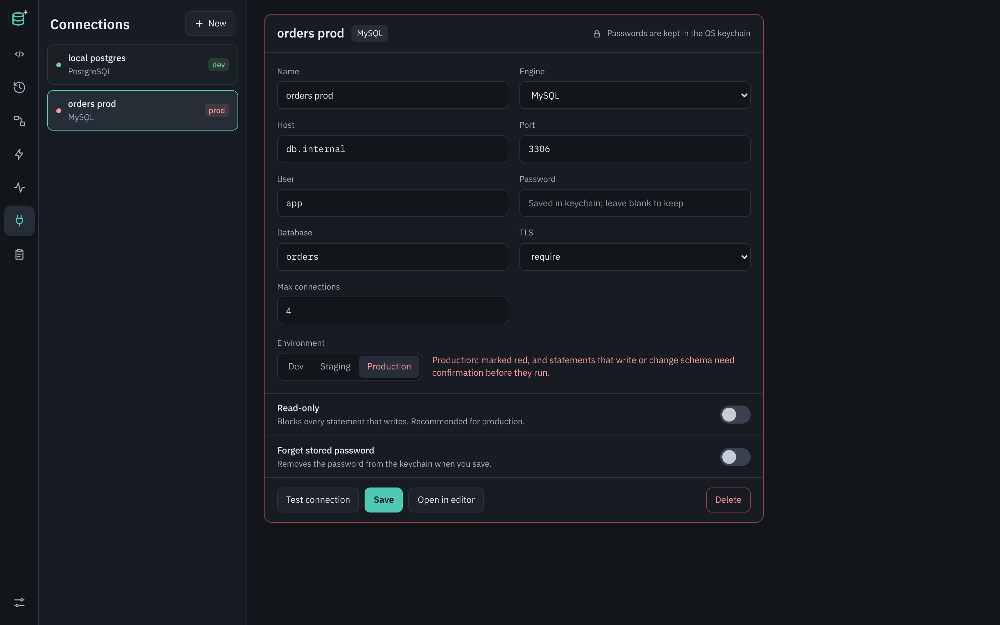
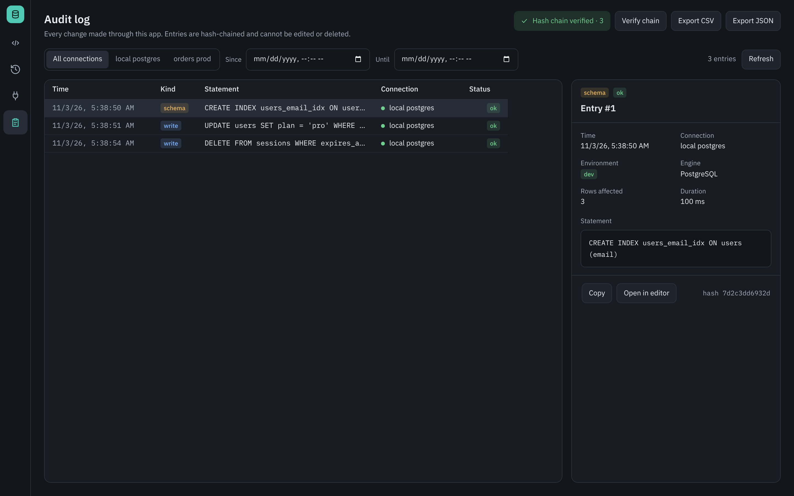
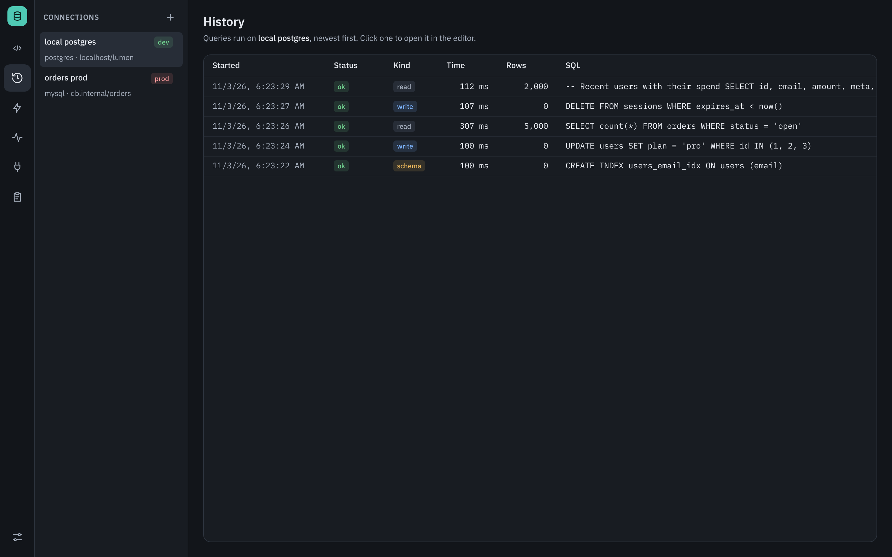
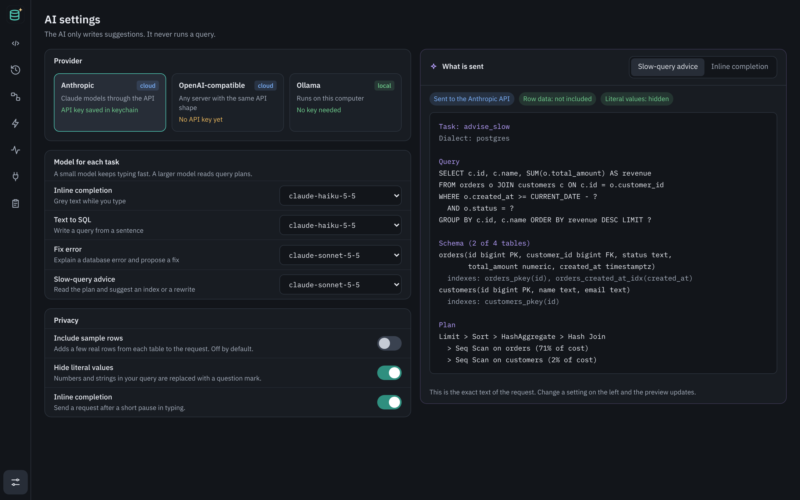
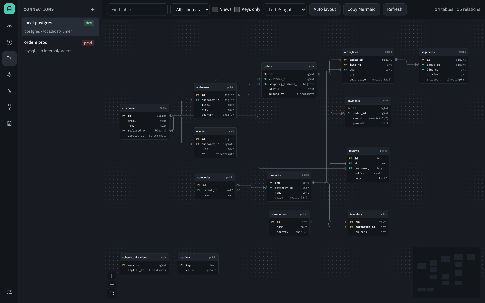

# lumen

A desktop SQL client for PostgreSQL, MySQL, and SQLite with an audit log, query
explain/debug tools, an AI assistant, a slow-query advisor, and a lock monitor.

- **Backend:** Go 1.26, one module, core in `internal/` (testable without the UI)
- **Shell:** Wails v3, isolated in `ui/shell`
- **Frontend:** React + TypeScript (`ui/frontend`)



## Screens

A dark UI in IBM Plex with an icon rail on the left for switching screens.

| Screen | What it does |
| --- | --- |
| **Query editor** | Connections sidebar; CodeMirror SQL editor; run with Ctrl/⌘+Enter and cancel mid-stream. Rows arrive in pages into a virtualized grid with a row cap. Production connections are marked red, and writes on them ask for confirmation |
| **History** | Past statements for the selected connection with status, kind, time, and row count; click one to reopen it in the editor |
| **Relations** | Interactive ER diagram (React Flow): tables with PK/FK columns, crow's-foot links between joined columns, auto layout left→right or top→bottom, drag, zoom, minimap. Click a table to highlight its relations and see references; focus on a table and its neighbours; find tables; filter by schema; keys-only view; double-click to query; copy as Mermaid |
| **Slow-query advisor** ¹ | Slowest queries by share of database time; the current plan with its most expensive step, an AI-suggested index or rewrite, and the plan cost before and after. A fix opens in the editor, so nothing runs until you run it |
| **Monitor** ¹ | Live sessions, connections, lock waits, cache hit rate, and the longest query, polled every 5 seconds; charts for connections and transactions per second; ending a session; alert rules |
| **Connections** | Saved PostgreSQL / MySQL / SQLite connections tagged Dev / Staging / Production; add, edit, test, delete. Passwords live in the OS keychain |
| **Audit log** | Append-only, hash-chained log of writes and schema changes; filter by connection and time, inspect an entry, verify the chain, export CSV or JSON |
| **AI settings** ¹ | Provider (Anthropic, OpenAI-compatible, Ollama), a model per task, privacy switches, and a preview of the exact text a request sends |

¹ The screen is built, but its backend comes later in [docs/plan.md](docs/plan.md): AI in
phase 3, the advisor in phase 4, the monitor in phase 5. Until then the desktop app shows
"not available yet" on these screens, and `make ui-dev` fills them with sample data.

<table>
  <tr>
    <td></td>
    <td></td>
  </tr>
  <tr>
    <td align="center">Slow-query advisor</td>
    <td align="center">Monitor</td>
  </tr>
  <tr>
    <td></td>
    <td></td>
  </tr>
  <tr>
    <td align="center">Connections</td>
    <td align="center">Audit log</td>
  </tr>
  <tr>
    <td></td>
    <td></td>
  </tr>
  <tr>
    <td align="center">History</td>
    <td align="center">AI settings</td>
  </tr>
  <tr>
    <td colspan="2"></td>
  </tr>
  <tr>
    <td colspan="2" align="center">Relations</td>
  </tr>
</table>

Screenshots are taken from `make ui-dev`, which runs the frontend in a browser
against an in-memory mock backend.

## Install

Download lumen for macOS, Windows, or Linux from the
[Releases page](https://github.com/phankieuphu/lumen/releases). The
[install and usage guide](docs/install.md) covers first launch on each system,
building from source, and how to use each screen.

## Develop

```sh
make tools      # install golangci-lint, gofumpt, govulncheck
make db-up      # PostgreSQL 17 + MySQL 8.4 in Docker
make test       # unit tests
make test-int   # integration tests against the containers
make lint
make app        # build the desktop app with the UI embedded, into bin/lumen
make ui-dev     # frontend on a mock backend at http://localhost:5173 (no Go needed)
make ui-check   # frontend typecheck, tests, and production build
```

## Docs

| Doc | What it covers |
| --- | --- |
| [docs/install.md](docs/install.md) | Install, first launch, and using lumen |
| [docs/plan.md](docs/plan.md) | Phases, milestones, tasks |
| [docs/architecture.md](docs/architecture.md) | Package layout and data flow |
| [docs/conventions.md](docs/conventions.md) | Code, commit, branch, and review rules |
| [CONTRIBUTING.md](CONTRIBUTING.md) | How to work on the repo |
| [SECURITY.md](SECURITY.md) | Reporting vulnerabilities |

## License

[MIT](LICENSE)
